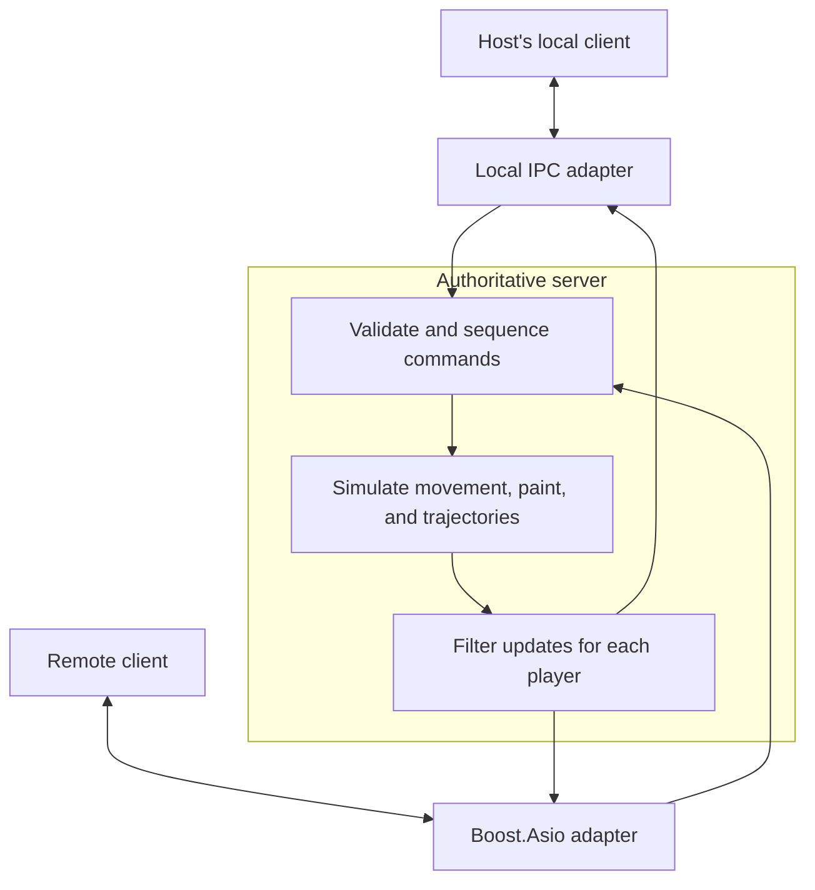

# Klawing

**A two-player paint duel where desktop windows become part of the arena.**

Klawing combines alternating 30-second rounds with real-time window movement. Throw paint across a shared canvas, use ricochets to threaten a hidden opponent, and drag your own window to dodge incoming blots. Every shot also changes the arena: paint builds up on the canvas, stains platforms, and makes routes through enemy-colored territory more expensive.

The project explores network programming and deterministic game simulation in modern C++. Its multi-window presentation is inspired by [Windowkill](https://torcado.itch.io/windowkill) by torcado. The name combines *клякса* (an ink blot), *Windows*, and *ping-pong*.

> **Status: early development.** The gameplay and architecture below describe the target design. Mechanics, balance, and presentation are being developed in stages.

## Gameplay

### The arena

Each player's computer presents the same logical five-window arena. The opponent's character window is hidden during aiming and briefly revealed when their confirmed shot is presented.

| Window | Count | Role |
| --- | --- | --- |
| Shared canvas | 1 | The scoring surface, with statistics and game controls below it. It stays horizontally centered and can move vertically without leaving the screen. |
| Player territory | 2 | The rectangular areas to the left and right of the canvas. Each contains a player's movable platform window and retains its own paint. |
| Character and platform | 2 | A draggable window containing a character and a separately painted platform. The character can move within the platform. |

Changing the canvas height changes the direction of shots and their subsequent ricochets. A platform expands as its character needs room and smoothly shrinks when possible. Players can adjust its desired minimum size; remaining enemy paint can prevent further shrinking.

### A round

1. **Position.** Move your character and platform, and adjust the canvas vertically to choose a useful firing angle.
2. **Aim.** Select a target and pull back to set throw strength. Choose the amount of paint independently; the trajectory preview follows the selected shot.
3. **Fire and react.** A confirmed shot is sent immediately. The opponent sees the permitted shot presentation and can dodge by dragging their own window. Movement remains available during either player's round.
4. **Finish.** End the round with the button below the canvas or let the 30-second timer expire. The proposed resolution order completes an accepted shot before handing shooting control to the opponent.

A normal round allows one shot. The **all-in** mode allows two within the same time limit.

### Paint, fuel, and consequences

- **Capture the canvas.** Each player's color accumulates opacity independently. A canvas cell becomes secured when one color first reaches full opacity; further enemy accumulation in that cell is blocked. The objective is the larger intensity-weighted share of the whole canvas at the end of the match.
- **Keep paint attached to its surface.** Paint on a platform moves with it. Paint on the territory stays in territory coordinates. Blots and scattered droplets remain until recolored.
- **Spend fuel strategically.** The character's paint reserve powers shots and work on enemy-colored areas. Moving across clean or friendly-colored space is free. The character repaints its platform, while the platform repaints the territory beneath it; cleaning can continue while stationary. Insufficient fuel limits further movement into paint that requires cleaning.
- **Separate strength from paint quantity.** Pulling back changes throw strength; the selected fuel portion controls the intended painting intensity. Stronger throws spread paint farther and lose more into scattered droplets. Excessive pull causes an explosion at the opponent's territory boundary.
- **Contaminate the opponent.** Enemy paint on the character mixes into its later shots. External hits can add up to 25% contamination in one opposing round, scaled by newly covered body area. Contamination fades over time.
- **Earn a spinning shot.** A hit by the main blot unlocks spin; droplets do not. An upward deviation from the character-to-target line produces counterclockwise rotation, and a downward deviation produces clockwise rotation. Spin changes the ricochet angle and widens droplet scatter.
- **Clean your side.** Shoot your platform or territory and ricochet toward the canvas. Starting a shot inside the character's bounding rectangle instead produces a self-shot with no ricochet. It spreads paint around the character and amplifies both its cleaning component and any contaminating enemy component.
- **Use poison.** Poison causes two stages of infection: enemy paint cannot initially be recolored, followed by a stage that permits removing it without adding friendly paint. Poison on a platform infects the character through contact and can be cleaned by shooting the platform first. On territory it remains visibly marked enemy paint; on the canvas it has no poison effect.
- **Go all-in.** After the platform has fully contracted to its allowed minimum around the character, expand it across your territory and perform a repainting pass. Choose each of two shots independently, with a per-shot limit of half the full fuel capacity. The fuel display desaturates half of the actual remaining liquid volume.
- **Dodge with a cost.** Abrupt window movement can shake the character into a platform edge. The resulting splatter paints the platform and exposed territory, while accumulated strain weakens a later shot. Infection reduces the character's stickiness and makes it easier to shake loose.

The result bar shows both players' shares and the gray uncaptured remainder. A crown is planned for a player whose weighted canvas share exceeds 50%; it is omitted from the schematic prototype.

### Desktop controls — target design

| Action | Input |
| --- | --- |
| Move the platform window | Drag its title bar. |
| Move the canvas | Drag the central window's title bar vertically. |
| Aim and set strength | Select a target, then pull back. |
| Change paint quantity | Mouse wheel or `+` / `-`, in steps of 10% of full fuel capacity. |
| Confirm a shot | Release the primary pointer. |
| Cancel aiming | Right mouse button. |
| End the round early | Use the button below the canvas. |

Touch input is planned alongside virtual windows. Its aim circle is split horizontally into an upper `+` button and a lower `-` button. A second touch changes the paint portion; a second touch outside the dashed circle cancels aiming.

## Technology stack

The selected dependency versions are managed through CMake `FetchContent`.

| Component | Selection | Purpose |
| --- | --- | --- |
| Language | C++26 | Game, client, and server code. |
| Build | CMake and Ninja | Dependency configuration and compilation. |
| Windows, graphics, and audio | [SFML 3.1.0](https://github.com/SFML/SFML) | Desktop windows, input, 2D rendering, and sound. |
| Remote transport | [Boost.Asio — `boost-1.92.0`](https://github.com/boostorg/asio) | Asynchronous network communication. |
| Wire format | [Protocol Buffers — `v36.2`](https://github.com/protocolbuffers/protobuf) | Typed message schemas and binary serialization. |
| Configuration | [reflect-cpp — `v0.26.2`](https://github.com/munich-data-engineering/reflect-cpp) | Mapping configuration data to C++ structures. |
| Logging | [spdlog — `v1.17.0`](https://github.com/gabime/spdlog) | Client and server diagnostics. |
| Command line | [CLI11 — `v2.7.2`](https://github.com/CLIUtils/CLI11) | Parsing application launch options. |
| Tests | [Google Test — `v1.18.0`](https://github.com/google/googletest) | Unit and integration testing. |

Boost.Asio is the Boost variant of Asio. Its required Boost dependencies must also be available to the build. Protocol version checks and message validation belong to the application protocol.

## Architecture

The client is the application entry point. Creating a game starts a separate local server process and connects to it through **inter-process communication (IPC)**. Joining a remote server uses **Boost.Asio**. TCP is proposed as the initial remote protocol.

The server owns the authoritative match state. Clients submit intentions and render the state they are permitted to see. The common simulation is designed around a fixed time step, a logical paint grid, and seeded randomness, independent of screen resolution and rendering frame rate.



This example shows a hosted network match. A local two-player test uses two clients and one server process, with local connections for both clients.

The design separates these responsibilities:

- **Simulation:** movement, collisions, trajectories, fuel, status effects, and scoring. Each surface stores the two players' opacity maps separately; the renderer combines them dynamically.
- **Server lifecycle:** creating and stopping an owned server process, independently of the transport used to communicate with it.
- **Transport and protocol:** message framing, delivery handling, schema negotiation, and duplicate-command protection across local and remote adapters.
- **Visibility:** public canvas state and permitted shot records, with private player state filtered per recipient. A shot record does not expose the shooter's later hidden movement.
- **Presentation and input:** native windows, aiming, interface feedback, and visual effects, without changing authoritative paint calculations.

Strategy interfaces provide extension points for transport, window layout, rendering, input, and configurable rules. Native Windows layouts are the first target; SFML-drawn virtual windows are planned for a later stage. A separate Vulkan renderer is under consideration. Matchmaking and mobile transports remain future work.

## Build

### Toolchain

- **Windows 10/11, x64:** the initial desktop target.
- **MinGW-w64 with GCC 15 or later:** the selected compiler direction, with support for the C++26 features used by the project.
- **CMake:** use the minimum declared in the root `CMakeLists.txt`; CMake 4.3 or later is recommended for this setup.
- **Ninja:** the generator used by the commands below.
- **Git and network access:** required to retrieve dependencies during the initial configuration.

C++26 support varies by compiler version. Refer to the [GCC implementation status](https://gcc.gnu.org/projects/cxx-status.html) when introducing additional language features.

### Configure and compile

Clone this repository: 

```bash
git clone https://github.com/Aeomanate/Klawing.git
```

Then:

```powershell
cmake -S . -B build/debug -G Ninja `
    -DCMAKE_BUILD_TYPE=Debug `
    -DCMAKE_C_COMPILER=gcc `
    -DCMAKE_CXX_COMPILER=g++

cmake --build build/debug --parallel
```

The [Ninja generator](https://cmake.org/cmake/help/latest/generator/Ninja.html) uses a single configuration per build directory. Select `Debug` at configuration time with `CMAKE_BUILD_TYPE`. Use a separate build directory when changing compilers or toolchains.

Launch the client target from the output directory defined by the project's CMake configuration, or through the IDE's run configuration. Hosting and joining follow the client-driven flow described above.

### Run registered tests

```powershell
ctest --test-dir build/debug --output-on-failure --no-tests=error
```

This runs tests registered with CTest. The `--no-tests=error` option reports an empty test registration as an error. 
Google Test is the selected framework; test coverage grows with the implementation.

## Development stages

1. **Prototype:** validate the network duel and gameplay using circles, four circular blot layers, simple frames, and schematic feedback. Priorities include deterministic painting, resource accounting, movement, and authoritative shot resolution.
2. **Graphics improvement:** introduce irregular blot contours, clearer layer overlap, a simple crown, and basic decoration.
3. **Mechanics and graphics polish:** refine balance and input; add animation, sound, tutorials, volumetric liquid shaders, and the accelerated presentation of confirmed shots. Expand customization toward player-drawn characters and platform shapes.

Detailed rules and open decisions are maintained in separate **Game Design (GDD)** and **Technical Design (TDD)** documents. Gameplay proposals are validated through prototypes and playtests before becoming fixed rules.
